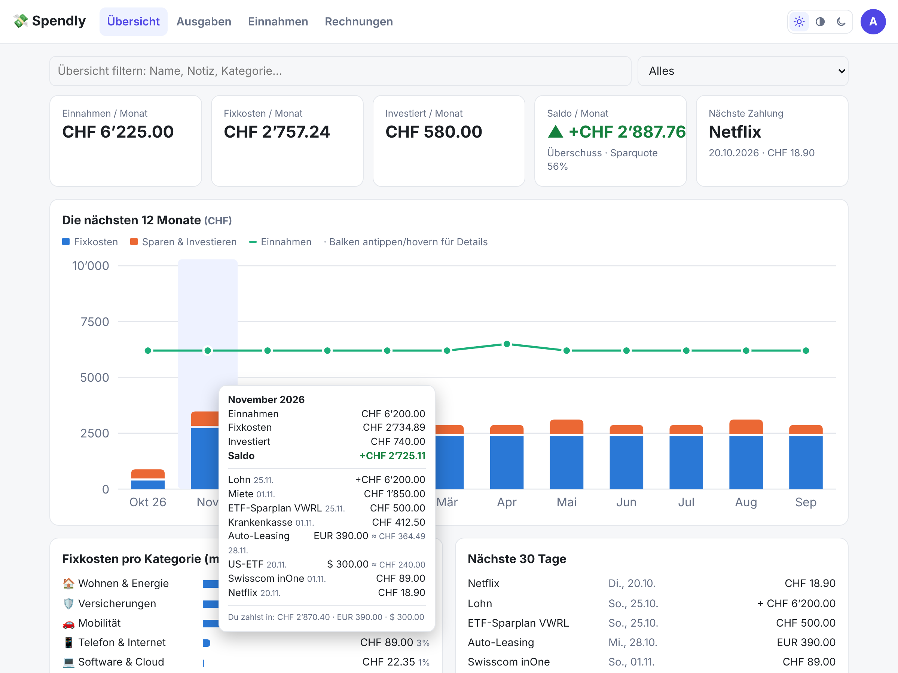
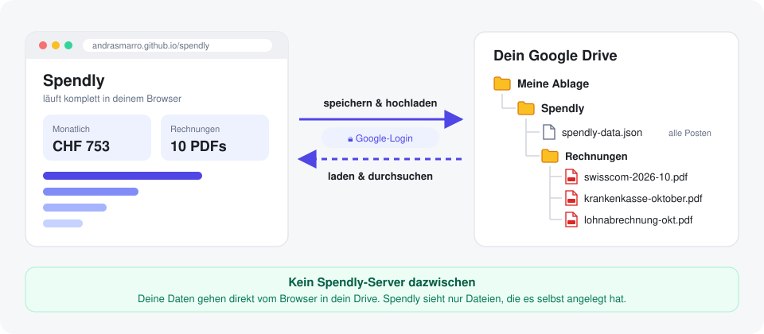
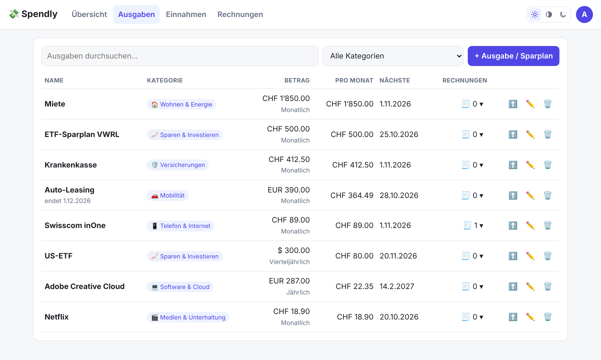
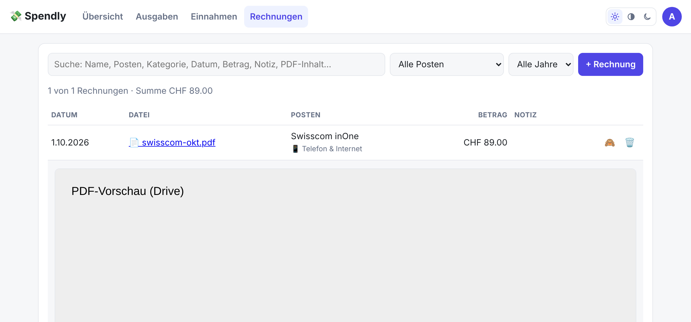
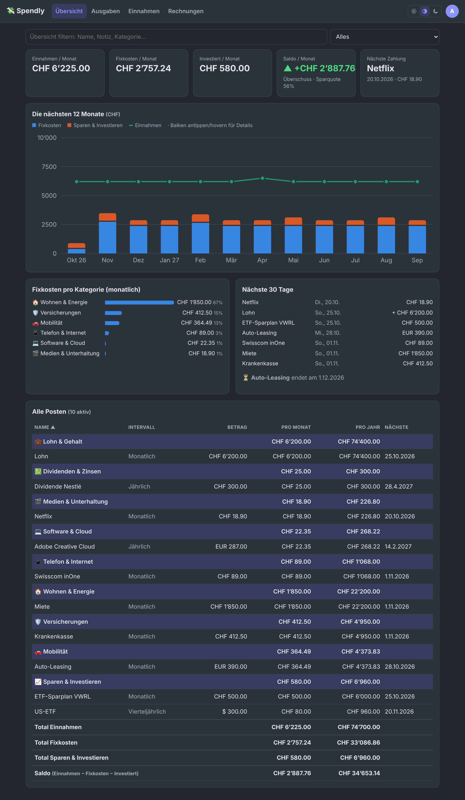
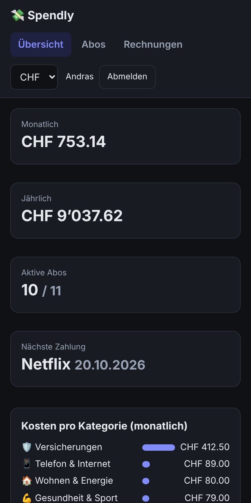

# 💸 Spendly

**Einnahmen, Ausgaben, Abos, Sparpläne und Rechnungen an einem Ort – gespeichert in deinem eigenen Google Drive.**

👉 **https://andrasmarro.github.io/spendly/**



Spendly zeigt dir auf einen Blick, wie viel reinkommt, was deine Fixkosten sind, wie viel du in ETFs & Aktien investierst
und was am Ende des Monats übrig bleibt. Zu jedem Posten legst du die Rechnungen ab und findest sie in Sekunden wieder.

---

## Deine Daten gehören dir



Du meldest dich mit Google an, und Spendly legt in **deinem Drive** einen aufgeräumten Ordner an:

```
Meine Ablage/
└── Spendly/
    ├── spendly-data.json   ← alle Posten & Einstellungen
    └── Rechnungen/         ← deine PDFs und Bilder
```

- **Überall verfügbar:** Die Rechnungen sind echte Dateien in deinem Drive. Du kannst sie auch ohne Spendly öffnen, teilen oder herunterladen.
- **Kein Server, keine Datenbank:** Spendly läuft komplett im Browser und spricht direkt mit Google. Niemand ausser dir sieht deine Daten.
- **Minimale Rechte:** Spendly sieht nur Dateien, die es selbst angelegt hat, nicht den Rest deines Drives.
- **Backup:** Im Menü kannst du jederzeit ein JSON-Backup herunterladen und wiederherstellen.

---

## Übersicht

- **Kennzahlen:** Einnahmen, Fixkosten, Investiert und **Saldo pro Monat** (Überschuss oder Defizit, mit Sparquote)
- **Die nächsten 12 Monate:** Balken für Fixkosten und Investiert, eine Linie für die Einnahmen.
  Fährst du über einen Monat (am Handy: antippen), siehst du jede einzelne Zahlung mit Datum,
  den Betrag in Originalwährung samt Umrechnung und **in welchen Währungen du zahlst**
- **Fixkosten pro Kategorie** mit Prozentanteil, **nächste 30 Tage** und Hinweise, wenn ein Vertrag bald endet
- **Alle Posten** als Tabelle, nach Kategorie gruppiert, mit Zwischensummen und Saldo
- **Filter** oben: Suche nach Name, Notiz oder Kategorie und Auswahl nach Art (nur Einnahmen, nur Fixkosten …).
  Der Filter wirkt auf alle Kennzahlen, Diagramme und Tabellen

## Ausgaben & Einnahmen



Ausgaben sind klar gruppiert:

| Gruppe | Kategorien |
|---|---|
| **Abos & Verträge** | 🎬 Medien & Unterhaltung · 💻 Software & Cloud · 📱 Telefon & Internet · 💪 Gesundheit & Sport · 🎓 Bildung |
| **Rechnungen & Fixkosten** | 🏠 Wohnen & Energie (Miete, Strom) · 🛡️ Versicherungen · 🚗 Mobilität · 🏦 Finanzen & Mitgliedschaften · 📦 Sonstiges |
| **Sparen & Investieren** | 📈 ETF- & Aktien-Sparpläne, Säule 3a (zählt nicht als Kosten) |
| **Einnahmen** (eigener Tab) | 💼 Lohn & Gehalt · 🛠️ Nebenerwerb · 💹 Dividenden & Zinsen · ↩️ Sonstige Einnahmen |

- Intervalle: wöchentlich, monatlich, alle 2 Monate, vierteljährlich, alle 4 Monate, halbjährlich, jährlich
- **Rund 30 Währungen** mit tagesaktuellen EZB-Kursen, alles umgerechnet in deine Basiswährung
- Optionales **Enddatum** (z.B. Leasing, befristete Verträge). Danach zählt der Posten nicht mehr
- Alle Tabellen sind **sortierbar**: Spaltenkopf anklicken, nochmals klicken für absteigend

## Rechnungen



- Beim Posten auf ⬆️ klicken und eine oder mehrere Rechnungen (PDF oder Bild) hochladen
- Mit 🧾 klappst du die Rechnungen eines Postens direkt in der Tabelle auf, mit 👁 zeigst du die **Vorschau** an oder blendest sie aus
- Die Suche findet Dateiname, Posten, Kategorie, Datum, Betrag, Notiz **und Text in deinen PDFs**

## Hell, Gedimmt oder Dunkel

Umschalten über die drei Symbole oben rechts. Die Wahl wird pro Gerät gespeichert.





## Ohne Anmeldung: Gastmodus

Mit **„Als Gast fortfahren“** speichert Spendly alles nur in deinem Browser.
Das ist praktisch zum Testen, aber: **Wenn du die Browserdaten löschst, ist alles weg.**
Über *Mit Google anmelden* kannst du deine Gastdaten samt Rechnungen jederzeit ins Drive übernehmen.

---

<sub>Entwicklung: statische Seite ohne Build-Schritt (`index.html` + `lib.mjs`). Lokal starten mit `python3 -m http.server 8000`, Tests mit `node lib.test.mjs`.</sub>
