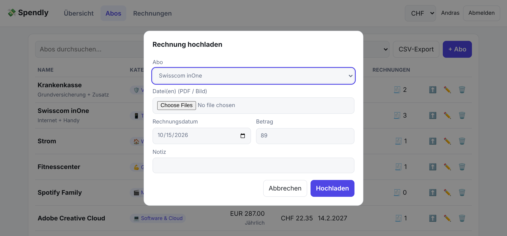

# 💸 Spendly

**Alle Abos, Kosten und Rechnungen an einem Ort – gespeichert in deinem eigenen Google Drive.**

👉 **https://andrasmarro.github.io/spendly/**

Spendly zeigt dir auf einen Blick, wie viel dich deine Abos pro Monat und pro Jahr kosten, wofür das Geld draufgeht
und welche Zahlungen als Nächstes fällig sind. Zu jedem Abo kannst du die Rechnungen ablegen und später in Sekunden wiederfinden.

---

## Deine Daten gehören dir

Du meldest dich mit Google an, und Spendly legt in **deinem Drive** zwei Dinge an:

| In deinem Drive | Inhalt |
|---|---|
| 📄 `spendly-data.json` | Alle Abos, Kategorien und Einstellungen |
| 📁 `Spendly Rechnungen` | Deine hochgeladenen Rechnungen als ganz normale PDFs/Bilder |

- **Überall verfügbar:** Die Rechnungen liegen als echte Dateien in deinem Drive. Du kannst sie auch ohne Spendly öffnen,
  teilen oder herunterladen, am Handy, am PC oder in der Drive-App.
- **Kein Server, keine Datenbank:** Spendly läuft komplett im Browser und spricht direkt mit Google. Niemand ausser dir sieht deine Daten.
- **Minimale Rechte:** Spendly darf nur Dateien sehen, die es selbst angelegt hat, nicht den Rest deines Drives.
- **Gratis und werbefrei.**

---

## Abos im Griff

- Abos mit Betrag, Währung und Intervall erfassen (wöchentlich bis jährlich)
- **CHF, EUR, USD, GBP** mit tagesaktuellen Wechselkursen, alles umgerechnet in deine Basiswährung
- Nächste Zahlung wird automatisch weitergerechnet
- Abos pausieren oder als gekündigt markieren, ohne die Historie zu verlieren
- Export als **CSV** für Excel oder die Steuererklärung

## Rechnungen hochladen

Mit einem Klick auf ⬆️ beim Abo lädst du eine oder mehrere Rechnungen (PDF oder Bild) hoch.
Datum und Betrag sind schon vorausgefüllt.

## Alles wiederfinden

Die Suche filtert schon beim Tippen nach Dateiname, Abo, Kategorie, Datum, Betrag und Notiz.
Sie findet **sogar Text in deinen PDFs** (über die Volltextsuche von Google Drive).
Zusätzlich kannst du nach Abo und Jahr filtern und siehst sofort die Summe der Treffer.

## Am Handy & im Dark Mode

---

## Kategorien

Klar abgegrenzt, ohne Doppelungen:

| Kategorie | Beispiele |
|---|---|
| 🎬 Medien & Unterhaltung | Netflix, Spotify, Games, Zeitungen |
| 💻 Software & Cloud | Adobe, iCloud, Microsoft 365, Domains |
| 📱 Telefon & Internet | Handy-Abo, Internet, TV-Anschluss |
| 🏠 Wohnen & Energie | Miete, Strom, Gas, Serafe |
| 🛡️ Versicherungen | Krankenkasse, Haftpflicht, Hausrat |
| 🚗 Mobilität | Halbtax/GA, Leasing, Parkplatz |
| 💪 Gesundheit & Sport | Fitnesscenter, Sportverein |
| 🎓 Bildung | Kurse, Sprach-Apps |
| 🏦 Finanzen & Mitgliedschaften | Kontogebühren, Kreditkarte, Spenden |
| 📦 Sonstiges | alles andere |

## Ohne Anmeldung: Gastmodus

Du willst Spendly nur ausprobieren? Mit **„Als Gast fortfahren“** speichert Spendly alles nur in deinem Browser.
Das ist praktisch zum Testen, aber: **Wenn du die Browserdaten löschst, ist alles weg.** Für den Alltag lieber mit Google anmelden.

---

Entwicklung: statische Seite ohne Build-Schritt (`index.html` + `lib.mjs`). Lokal starten mit `python3 -m http.server 8000`, Tests mit `node lib.test.mjs`.
